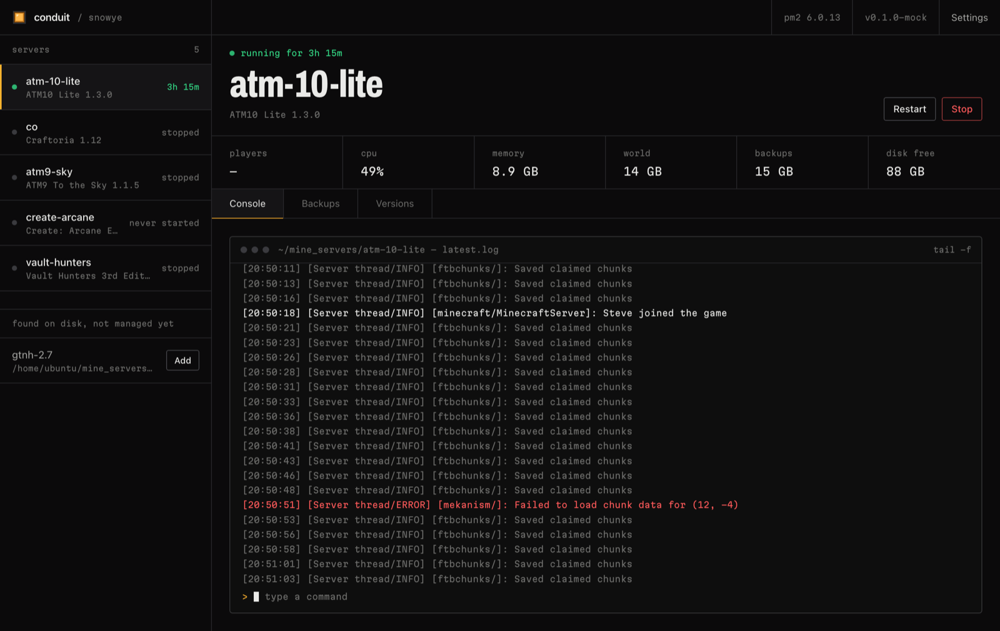

# Conduit

Run the Minecraft servers on one machine from your phone. Start and stop them,
read the log, send console commands, take and restore backups, and upgrade a
modpack with a one-tap way back.

One binary with the web app built in. It joins your Tailscale network, so only
you can reach it, and it drives the servers through pm2.



## Install

```sh
curl -fsSL https://raw.githubusercontent.com/Sn0wye/conduit/main/install.sh | bash
```

Linux and macOS, x64 and arm64. The installer downloads the latest release,
checks its checksum, sets it up as a service (systemd on Linux, launchd on
macOS) and prints the Tailscale link that signs the machine in. Open the address
it gives you; the first tailnet login to open it owns the machine.

Run the same command again to upgrade. Your data in `~/.conduit` is never
touched.

| Want to | Run |
| --- | --- |
| Pick a version | `curl … \| bash -s -- --version v0.2.0` |
| Skip the browser login | `curl … \| TS_AUTHKEY=tskey-auth-… bash` |
| Use the Tailscale already on the machine | `curl … \| bash -s -- --host-port 8420` |
| Only put the binary in place | `curl … \| bash -s -- --no-service` |
| Uninstall | `curl … \| bash -s -- --uninstall` |

With sudo it installs to `/usr/local/bin` as a system service that runs as you;
without it, to `~/.local/bin` as a user service.

### What it expects

- [pm2](https://pm2.keymetrics.io) on the machine (`npm install -g pm2`)
- servers that start with `./run.sh`, in `~/mine_servers`, `~/servers` or
  `~/minecraft` (you can point it elsewhere in settings)
- for the installable app: MagicDNS and HTTPS Certificates turned on in the
  Tailscale admin console

### Sharing

```sh
conduitd --allow friend@example.com    # let someone else in
conduitd --revoke friend@example.com
conduitd --claim you@example.com       # hand the machine to another login
```

## Develop

```sh
make dev                    # API on http://127.0.0.1:8420, no tailnet
cd web && bun run dev       # the app with hot reload, proxied to it
cd web && bun run dev:mock  # the app against a fake API, no server needed
make test
make deploy HOST=user@host  # build this checkout and install it over ssh
```

Releases: push a tag (`git tag v0.1.0 && git push origin v0.1.0`) and the
release workflow builds every platform and publishes what the installer
downloads.

How it works and why: [DESIGN.md](DESIGN.md).
